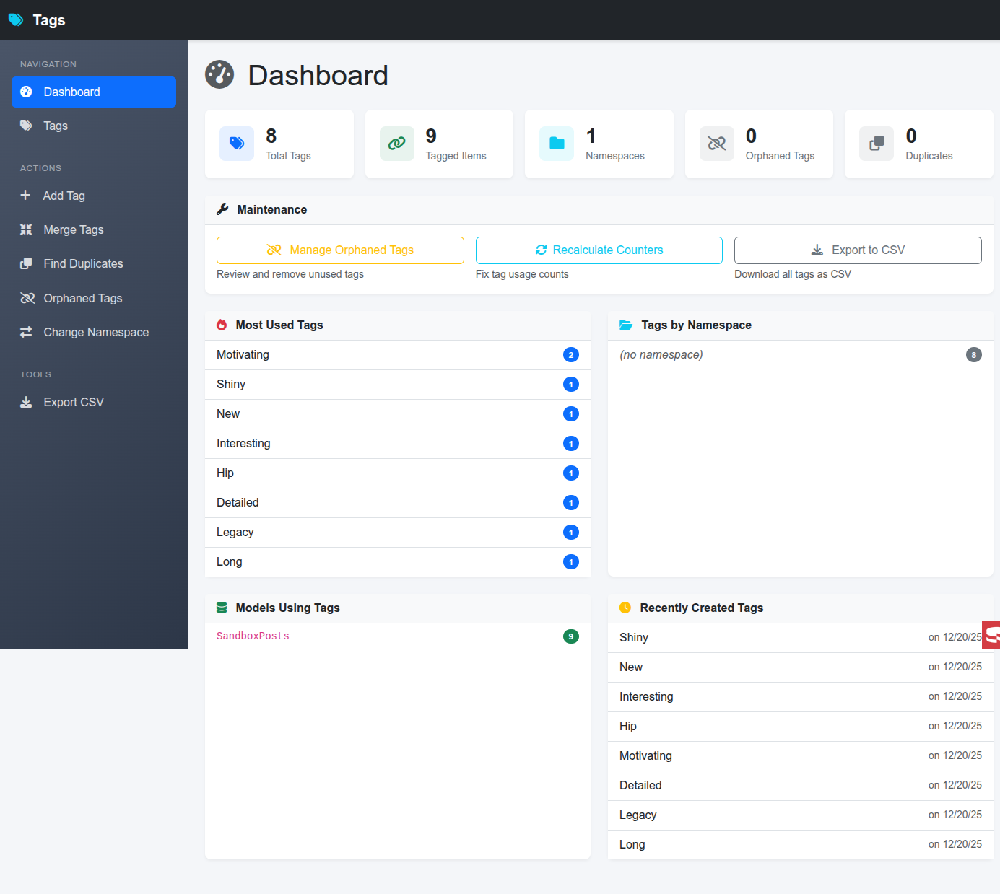
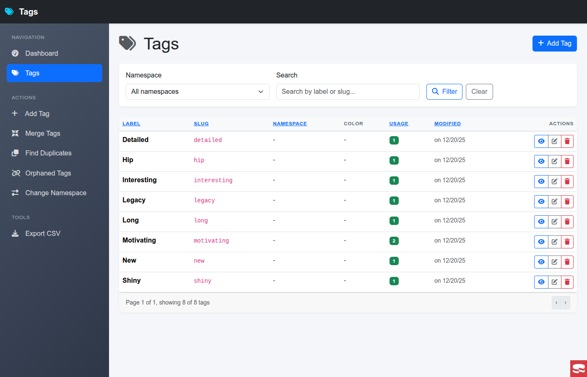

# Admin interface

Loading Tags routes enables the dashboard at `/admin/tags` and tag management at `/admin/tags/tags`. The interface provides tag CRUD, merge previews, duplicate suggestions, orphan cleanup, counter recalculation, export and namespace moves.

The plugin layout uses Bootstrap 5.





## Access control

By default, admin controllers inherit the application's `AppController` initialization and `beforeFilter()`. Keep your existing admin authentication and authorization in place. The inherited `beforeFilter()` callback must be untyped or use `void`, matching the plugin callback. Tags does not install Authentication or define an admin role for you.

An optional additional gate receives the request and must return literal `true`:

```php
use Cake\Core\Configure;
use Cake\Http\ServerRequest;

Configure::write('Tags.accessCheck', function (ServerRequest $request): bool {
    $identity = $request->getAttribute('identity');

    return $identity !== null && in_array('admin', (array)$identity->get('roles'), true);
});
```

Adapt the field lookup to your identity. An unset gate leaves access decisions to the host application. A non-Closure, `false` or truthy non-boolean result rejects access. Explicit ForbiddenException is preserved; other gate exceptions are logged and converted to a generic 403.

When a configured gate runs with the Authorization component, it calls `skipAuthorization()`. The gate must therefore make the complete access decision for these plugin actions. Host redirects and stopped events are preserved.

## Standalone mode

```php
Configure::write('Tags.standalone', true);
```

This bypasses the host `AppController` initialization and `beforeFilter()` callbacks. It still needs that class to exist, and it does not disable application middleware. Other inherited hooks, including `beforeRender()`, `afterFilter()` and custom event mappings, still apply; keep those hooks compatible with the components loaded in standalone mode. Configure an access gate or equivalent application middleware before exposing standalone admin routes.

## Layout

Merge the needed keys into the application's `Tags` configuration:

```php
'Tags' => [
    'adminLayout' => false,
    'adminBackUrl' => ['plugin' => null, 'prefix' => null, 'controller' => 'Pages', 'action' => 'display', 'home'],
    'adminBackLabel' => 'Back to the application',
],
```

`adminLayout => null` selects `Tags.tags`; `false` uses the application's default layout; a string selects that layout. Back-link options apply to the plugin layout. The repository's `config/app.example.php` contains application configuration examples.

## Maintenance

Duplicate suggestions are candidates to review, not proof that two labels mean the same thing. Merge requires source and target tags in the same namespace. Orphan deletion uses cached global counters, so recalculate them first if SQL changes or earlier failures left those counters stale.

The counter recalculation action repairs tag counters. It does not rebuild each tagged model's optional `tag_count` column. Namespace moves check for slug conflicts and use a transaction; concurrent edits still depend on the database constraints and isolation level.
